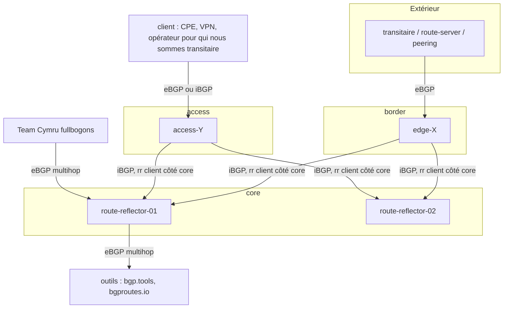

# Rôle bird : architecture

Ce rôle déploie BIRD 3 pour l'infrastructure BGP de Neutrinet (AS 204059). Chaque routeur a un rôle, fixé par `bird_role` dans ses host_vars :

- `core` : les deux route-reflectors (`route-reflector-01` et `route-reflector-02` en production, `core-main-01` et `core-main-02` dans le
  laboratoire GNS3). Ils portent aussi les sessions Team Cymru et les sessions vers les outils d'observation, et chacun héberge un cache Routinator.
- `border` : les routeurs de bordure (`edge-*` en production, `border-*` dans le laboratoire), qui portent les sessions eBGP vers les transitaires,
  les route-servers et les peerings bilatéraux.
- `access` : les routeurs d'accès (`bra-01`, `bra-02`, `core-patata-01`, `core-patata-02` en production, `access-*` dans le laboratoire), qui
  portent les sessions vers les clients.

Voir aussi :

- [filters-and-communities.md](filters-and-communities.md) : fonctions de filtrage à l'import et à l'export, schéma des communautés BGP, RTBH ;
- [irr.md](irr.md) : les deux mécanismes de prefix-lists IRR (dynamique avec bgpq4, statique avec Ansible).

## Fichiers de configuration

`bird.conf.j2` inclut, dans cet ordre, `/etc/bird/irr/*.conf`, `/etc/bird/conf.d/*.conf`, puis les sessions de
`/etc/bird/peers/upstreams/*.conf` et `/etc/bird/peers/downstreams/*.conf`.

| Fichier | Contenu |
| --- | --- |
| `conf.d/10_bgp_filters_hygiene.conf.j2` | Listes (`NEUTRINET_PREFIXES_V4/V6`, bogons, LAN d'IX, ASN privés, tier 1) et fonctions de rejet communes |
| `conf.d/10_bgp_filters_policy.conf.j2` | Politique de routage : RTBH, communautés, local preference, fonctions d'import et d'export par type de session |
| `conf.d/10_protocols.conf.j2` | Protocoles `device` et `direct` (ce dernier s'appelle `direct1` dans les filtres) |
| `conf.d/10_bfd.conf.j2` | BFD sur toutes les interfaces, 500 ms x 6 |
| `conf.d/16_bgp_templates.conf.j2` | Gabarits BGP `bgp_common`, `bgp_internal`, `bgp_std`, `bgp_internal_std` et `bgp_rr_client` |
| `conf.d/20_bgp_rpki.conf.j2` | Sessions RTR vers les deux caches Routinator (ROA et ASPA) |
| `conf.d/80_static.conf.j2` | Routes par défaut `default_gw_v4` et `default_gw_v6` |
| `conf.d/80_static-host.conf.j2` | Routes statiques propres à l'hôte : nos agrégats sur les cores, `bird_internal_service_routes` ailleurs |
| `conf.d/90_kernel.conf.j2` | Export vers la table noyau 1011 de la VRF `routing` |
| `peers/<type>.conf.j2` | Une session BGP par entrée de `bird_peers_upstreams` ou `bird_peers_downstreams`, un fichier par type de peer |

Toutes les sessions et toutes les tables vivent dans la VRF `routing`.

## Topologie

Chaque routeur de bordure et chaque routeur d'accès a deux sessions iBGP, une vers chaque core. Il n'y a pas de maillage complet entre bordures et
accès : une route apprise par une bordure n'atteint un autre routeur qu'en passant par les cores. C'est pourquoi les sessions des cores vers les
bordures et les accès utilisent le gabarit `bgp_rr_client` (`rr client`) : sans lui, la règle de l'iBGP interdirait au core de réannoncer à un pair
iBGP une route apprise d'un autre pair iBGP.

Toutes les sessions iBGP passent sur IPv6 et transportent les deux familles, avec `extended next hop on` pour IPv4, `add paths on` et
`next hop self`.

### VLAN de routage

Les sessions iBGP passent sur le VLAN 13, en adresses globales de `2001:913:1000:101::/64` : chaque routeur y porte `2001:913:1000:101::1:<id>`,
où `<id>` est le même identifiant que pour son management (`2001:913:1000:10::<id>`) et sa loopback (`2001:913:1000:100::<id>`, sauf
les cores en `::191` et `::192`). Le VLAN 13 ne porte pas d'IPv4.

Le `1:` devant l'identifiant est voulu. En prod, le VLAN 13 passe par les VF des cartes Intel X710 des Proxmox. Une X710 livre une trame
multicast qui correspond au filtre d'une VF à cette VF seulement, sans copie vers le PF ponté. Une adresse pontée (management en virtio, hôte
Proxmox) dont le groupe solicited-node (`33:33:ff:` suivi des 24 derniers bits) est le même que celui d'une adresse de VF ne reçoit donc plus
les sollicitations de voisin. Avec `::1:<id>`, le troisième octet n'est jamais nul et le groupe ne peut pas être celui d'une adresse `::<id>`.
Un assert de `tasks/config.yml` refuse tout voisin iBGP hors de ce schéma.

Les adresses de VF imposées par des tiers (IX, transit, backhaul) restent possibles. Le rôle `proxmox` y répond : il génère, à partir des facts
des VM réseau, la liste de toutes les adresses portées par une VF, et le service `neutrinet-pf-mcast` abonne le bond des PF à leurs groupes.
Ajouter une VM pontée ne demande rien ; ajouter ou renuméroter une VM réseau demande de relancer `playbooks/apps/proxmox.yml`.

## Types de peers

Chaque entrée de `bird_peers_upstreams` ou `bird_peers_downstreams` a un `type:` qui choisit le fichier `peers/<type>.conf.j2`, le gabarit BGP et
la paire de fonctions d'import et d'export.

| Type | Où | Session | Import | Export |
| --- | --- | --- | --- | --- |
| `transit` | border | eBGP | `bgp_import_transit_to_border` | `bgp_export_border_to_transit` |
| `route-server` | border | eBGP | `bgp_import_route_server_to_border` | `bgp_export_border_to_route_server` |
| `peering` | border | eBGP | `bgp_import_peering_to_border` (avec IRR) | `bgp_export_border_to_peering` |
| `client` | access | eBGP, ou iBGP si `asn` vaut notre ASN | `bgp_import_client_to_access` (avec IRR) | `bgp_export_access_to_client` (défaut des cores seule) |
| `core` | border, access | iBGP | `bgp_import_core_to_border` ou `bgp_import_core_to_access` | `bgp_export_border_to_core` ou `bgp_export_access_to_core` |
| `border` | core | iBGP, rr client | `bgp_import_border_to_core` | `bgp_export_core_to_border` |
| `access` | core | iBGP, rr client | `bgp_import_access_to_core` | `bgp_export_core_to_access` |
| `tools` | core | eBGP multihop | aucun | `bgp_export_core_to_tools` |
| `bogons` | core | eBGP multihop | `bgp_import_bogons_to_core` | aucun |

Ce que chaque session transporte entre les rôles internes :

- une bordure envoie aux cores ce qu'elle a appris en eBGP (`my_asn:0:20`), les routes clientes et nos agrégats (`my_asn:0:30`), nos propres
  réseaux (`my_asn:0:40`) et ses réseaux connectés compris dans nos préfixes ;
- un core envoie aux bordures les routes clientes et nos agrégats (`my_asn:0:30`), nos propres réseaux (`my_asn:0:40`), les bogons Team Cymru
  (`my_asn:0:60`) et les blackholes RTBH ; il ne leur renvoie pas les routes eBGP apprises par les autres bordures ;
- un routeur d'accès envoie aux cores les routes de ses clients, nos propres réseaux et ses réseaux connectés compris dans nos préfixes ;
- un core envoie aux routeurs d'accès la route par défaut (`default_gw_v4` et `default_gw_v6`) et les bogons Team Cymru ;
- un core envoie aux outils d'observation les routes apprises en eBGP telles quelles, et les routes clientes filtrées comme vers un transitaire
  (contrôles d'export, sans RTBH ni communautés `my_asn:0:*`).

Le type `client` couvre la session privée vers une CPE, le VPN et le cas où nous sommes le transitaire d'un opérateur externe : tous partagent la
même forme de filtre, une prefix-list IRR obligatoire à l'import et la seule route par défaut à l'export.

## Paramètres des peers

| Clé | Types | Rôle |
| --- | --- | --- |
| `asn`, `name`, `slug`, `type` | tous | Identité de la session ; `slug` nomme le protocole BIRD et les prefix-lists `irr_<slug>_v4/v6` |
| `neighbor_ipv4`, `neighbor_ipv6` | tous | Adresse du voisin ; les types eBGP créent une session par famille renseignée, les autres une seule session IPv6 |
| `neighbor_ipv4_interface`, `neighbor_ipv6_interface` | tous | Interface du voisin (session `direct`), obligatoire pour une adresse de lien local |
| `neighbor_ipv4_password`, `neighbor_ipv6_password` | tous | Mot de passe TCP MD5, à tirer du vault |
| `passive`, `multihop` | selon le gabarit | Session passive ; session multihop (`core`, `border`, `access`, `tools`, `bogons`) |
| `max_prefix_v4`, `max_prefix_v6` | `transit`, `route-server`, `peering`, `client` | Obligatoires, voir ci-dessous |
| `max_prefix_v4`, `max_prefix_v6`, `max_prefix_action` | `bogons` | Facultatifs : limite d'import et son action (`block` par défaut) |
| `irr_filtered`, `irr_as_set`, `irr_as_set_v6` | `peering`, `client` | Prefix-list IRR dynamique, voir [irr.md](irr.md) |
| `irr_static_v4`, `irr_static_v6` | `peering`, `client` | Prefix-list IRR statique, voir [irr.md](irr.md) |
| `local_pref` | `transit` | Remplace la local preference par défaut (100) de ce transitaire |
| `prepend` | `transit` | Nombre de prepends (0 à 3) de notre ASN sur nos propres routes |

Variables d'hôte utiles en plus des identifiants du routeur (`bird_router_id`, `bird_my_asn`, `bird_router_source_ipv4/v6`,
`bird_server_rpki_01/02`) :

- `bird_role` : `core`, `border` ou `access` ;
- `bird_ixp_locality` (border) : `private`, `belgiumix`, `bnix` ou `nlix`, utilisé dans les communautés informatives ;
- `bird_transit_asns` : ASN de nos transitaires, signalés aux route-servers pour qu'ils ne leur annoncent pas nos routes ;
- `bird_client_export_local_pref` (access) : local preference des routes clientes envoyées aux cores ;
- `bird_internal_service_routes` (hors core) : routes statiques internes, marquées `my_asn:0:40` ;
- `bird_krt_prefsrc_override` : adresse source IPv4 du noyau pour un préfixe donné ;
- `bird_threads` : nombre de threads de BIRD (2 par défaut).

`tasks/config.yml` vérifie avant tout déploiement que :

- tout peer `transit`, `route-server`, `peering` ou `client` a `max_prefix_v4` et `max_prefix_v6` ;
- `irr_filtered` n'est jamais posé sur un `transit` ou un `route-server`, où il ne filtrerait rien ;
- `irr_static_v4` et `irr_static_v6` sont définis ensemble ou pas du tout, sur un client ou un peer filtré par IRR ;
- `prepend` d'un transitaire vaut 0, 1, 2 ou 3.

## Limites de préfixes

Sur les sessions `transit`, `route-server`, `peering` et `client`, chaque famille a :

- `import limit <max_prefix> action restart` : au-delà de `max_prefix` routes acceptées, la session est coupée ;
- `receive limit <2 x max_prefix> action restart` : au-delà du double de routes reçues, filtrées comprises (`import keep filtered`), la session est
  aussi coupée, ce qui protège la mémoire contre un voisin qui enverrait surtout des routes rejetées.

Après une coupure, BIRD retente la connexion selon `error wait time`, laissé à sa valeur par défaut : 60 s, puis un délai qui double à chaque
nouvelle erreur jusqu'à 300 s.

## Rôles BGP (RFC 9234) et autres protections eBGP

`local role` est posé dans `peers/<type>.conf.j2`, sur les sessions eBGP seulement :

| Type | `local role` |
| --- | --- |
| `transit` | `customer` |
| `peering` | `peer` |
| `route-server` | `rs_client` |
| `client` (eBGP seulement) | `provider` |

`require roles` n'est pas activé : un voisin qui n'annonce pas la capacité Role établit quand même la session, sans protection OTC. GTSM
(`ttl security`) n'est pas utilisé, faute de mode « proposé sans être exigé » dans BIRD.

`enforce first as on` est posé sur les sessions `transit`, `peering` et `client` eBGP. Il ne l'est pas sur `route-server`, puisqu'un route-server
n'ajoute pas son ASN au chemin.

Le filtre tier 1 (`TIER1_ASNS`, `reject_tier1_asns`) s'applique aux imports `peering`, `route-server` et `client` : un pair, un membre d'IX ou un
client ne doit pas nous transmettre de routes apprises de son propre transitaire.

L'import d'un peering bilatéral exige que le next hop soit l'adresse du voisin (`bgp_next_hop = from`).

## Gabarits, temporisations et BFD

| Gabarit | Sessions | Réglages |
| --- | --- | --- |
| `bgp_common` | toutes | `local as my_asn`, graceful restart, LLGR, `import keep filtered` |
| `bgp_std` | `transit`, `route-server`, `peering`, `client`, `tools`, `bogons` | `hold time 90`, `keepalive time 30`, `next hop self`, `import table on` |
| `bgp_internal` et `bgp_internal_std` | `core` | `bfd graceful`, `next hop self` |
| `bgp_rr_client` | `border`, `access` (côté core) | comme `bgp_internal_std`, avec `rr client` |

Graceful restart : nous annonçons un temps de redémarrage nul (`graceful restart time 0`) et un temps de conservation LLGR de 120 s. Les valeurs
annoncées par les voisins sont plafonnées à 120 s (`max graceful restart time 120`, `max long lived stale time 120`).

BFD (`conf.d/10_bfd.conf.j2`, 500 ms x 6, soit une détection en 3 s) ne sert qu'aux sessions iBGP. Les sessions eBGP n'utilisent pas BFD et
reposent sur le hold time de 90 s.

Les sessions eBGP gardent une Adj-RIB-In (`import table on`), ce qui permet de recharger les filtres sans redemander les routes au voisin.

## Team Cymru fullbogons

Les cores portent les sessions `bogons` vers Team Cymru (AS 65332). Seules les routes marquées `65332:888` sont acceptées, jamais la route par
défaut, nos préfixes ni ceux de NS-Global. Elles reçoivent `my_asn:0:60`, une local preference de 500 et deviennent des blackholes, puis sont
relayées à toutes les bordures et à tous les accès. Aucun export eBGP ne les accepte, et chaque export noyau les installe en blackhole avant toute
autre règle.

## RPKI et ASPA

`conf.d/20_bgp_rpki.conf.j2` ouvre deux sessions RTR (`routinator_1` et `routinator_2`, port 3323) vers les caches Routinator des deux
route-reflectors (`bird_server_rpki_01/02`). Elles alimentent les tables `roa_v4`, `roa_v6` et `aspa_t`. En cas de perte des deux caches, les
données restent valides 48 h (`expire keep 172800`).

Routinator (rôle `routinator`) valide les données RPKI publiques sans exception SLURM locale et publie aussi les objets ASPA (`enable-aspa`).

- ROV : une route invalide est rejetée à l'import et à l'export de toutes les sessions externes. À l'export, nos propres routes (chemin vide) sont
  vérifiées avec notre ASN comme origine, pour ne jamais annoncer un préfixe que nos propres ROA invalident.
- ASPA : à l'import, `aspa_check_downstream` pour un transitaire, `aspa_check_upstream` pour un peering, un route-server ou un client ; une route
  `ASPA_INVALID` est rejetée.

## Local preference

`bgp_local_pref_calcul()` : `transit` = 100, `route-server` = 110, `peering` = 120, tout le reste (client, nos réseaux) = 190. Un blackhole RTBH
reçoit 900 et un bogon Team Cymru 500.

Une route qui porte la communauté GRACEFUL_SHUTDOWN (`65535:0`) reçoit une local preference de 0 à l'import d'un transitaire, d'un route-server,
d'un peering ou d'un client (hors RTBH).

Un transitaire peut remplacer sa valeur avec la clé `local_pref`, et demander des prepends de notre ASN sur nos propres routes (chemin vide, donc
jamais une route cliente) avec `prepend` (0 à 3).

Un routeur d'accès peut abaisser la local preference des routes clientes qu'il envoie aux cores avec `bird_client_export_local_pref`. Quand deux
routeurs d'accès servent les mêmes clients, celui sans la clé (190) porte seul le trafic et l'autre (par exemple 180) prend le relais s'il
disparaît, au lieu d'un partage ECMP.

## Routes statiques

- `default_gw_v4` et `default_gw_v6` (`conf.d/80_static.conf.j2`). Sur un core, c'est une route `recursive` vers le serveur racine K
  (`193.0.14.129`, `2001:7fd::1`) : tant que la table des bordures porte ce préfixe, elle pointe vers la bordure qui y mène et elle est envoyée
  aux accès ; si le core perd les bordures, elle devient `unreachable` et `bgp_export_core_to_access` ne l'envoie plus (`dest = RTD_UNICAST`).
  Sur une bordure, c'est une route `unreachable`, la route par défaut de la VRF. Sur un routeur d'accès, elle a la préférence 1 et ne sert
  que de repli quand la route par défaut des cores disparaît, ce qui évite que la recherche dans la VRF ne retombe sur la table principale.
  Elle n'est jamais annoncée aux clients : `bgp_export_access_to_client` n'exporte qu'une route par défaut apprise en BGP, si bien qu'un accès
  coupé des deux cores retire sa défaut et que le client bascule sur l'autre accès.
- Sur un core (`conf.d/80_static-host.conf.j2`) : nos agrégats 80.67.181.0/24, 80.67.191.0/24 et 2001:913:1000::/36 en `unreachable`, marqués
  `my_asn:0:30` avec une local preference de 190. Ce sont eux qui sont annoncés à l'extérieur.
- Ailleurs : les routes de `bird_internal_service_routes`, marquées `my_asn:0:40`.

## Export vers le noyau (`conf.d/90_kernel.conf.j2`)

`kernel_v4` et `kernel_v6` exportent vers la table 1011 de la VRF `routing`, avec `merge paths on` (ECMP). Le filtre est le même sur tous les
rôles :

1. `my_asn:0:60` (bogons Team Cymru) : installé en blackhole ;
2. route par défaut : installée telle quelle ;
3. `my_asn:0:40` (nos réseaux) : installé tel quel ;
4. `my_asn:0:30` : nos agrégats (chemin vide) deviennent `unreachable` sauf s'ils sont déjà des blackholes, les routes clientes gardent leur next
   hop ;
5. `my_asn:0:20` (appris en eBGP) : installé tel quel ;
6. tout le reste est refusé.

L'adresse source du noyau (`krt_prefsrc`) vaut `bird_router_source_ipv4/v6`, sauf pour le préfixe IPv4 éventuellement donné par
`bird_krt_prefsrc_override`.

Le `scan time` vaut 10 s sur les cores et les accès, qui portent les routes ECMP touchées par les bascules (routes clientes des deux accès,
route par défaut des deux cores), et 120 s sur les bordures. Les cores installent aussi la table des bordures (`my_asn:0:20`) : le scan y relit
une table complète toutes les 10 s, coût accepté pour borner la coupure. BIRD 3.4.0 perd parfois la mise à jour d'une route ECMP qui perd
un chemin : le noyau garde le chemin mort jusqu'au scan suivant, qui resynchronise la table.
