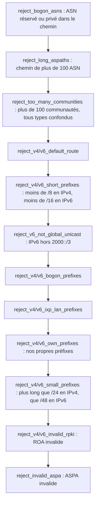
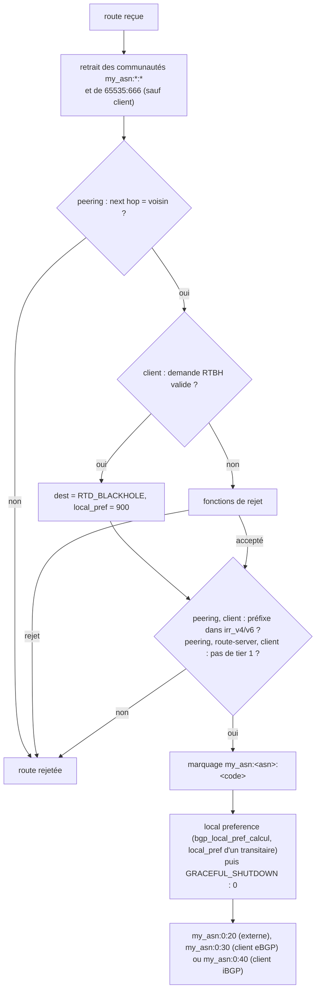
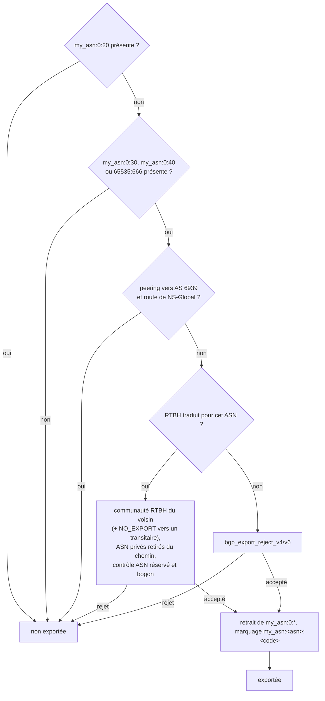
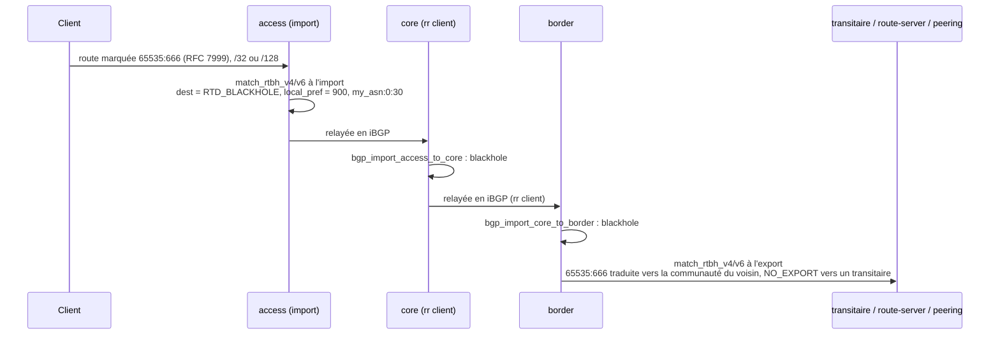

# Filtres et communautés

Sources : `templates/bird/conf.d/10_bgp_filters_hygiene.conf.j2` pour les listes et les fonctions de rejet communes,
`templates/bird/conf.d/10_bgp_filters_policy.conf.j2` pour la politique (RTBH, communautés, local preference, import et export par type de
session). La table complète des valeurs de communautés est déployée sur chaque routeur dans `/etc/bird/community.md` (source :
`templates/bird/community.md.j2`) ; cette page décrit le mécanisme.

## Communautés internes

Les communautés larges `my_asn:0:X` portent l'état d'une route à l'intérieur de l'AS. Elles sont retirées à l'import de toute session externe et à
l'export vers toute session externe.

| Communauté | Fonction de test | Sens |
| --- | --- | --- |
| `my_asn:0:20` | `bgp_learned_by_ebgp()` | Route apprise d'un transitaire, d'un route-server ou d'un peering |
| `my_asn:0:30` | `bgp_learned_by_client()` | Route d'un client eBGP, ou l'un de nos agrégats (statique sur les cores) : candidate à l'export externe |
| `my_asn:0:40` | `bgp_is_own_network()` | Nos réseaux internes : réseaux connectés compris dans nos préfixes, `bird_internal_service_routes`, client iBGP |
| `my_asn:0:60` | `bgp_is_bogon_blackhole()` | Bogon Team Cymru, installé en blackhole et jamais exporté hors de l'AS |

## Fonctions de rejet communes

Les listes de référence sont définies dans `10_bgp_filters_hygiene.conf.j2` :

- `NEUTRINET_PREFIXES_V4` (80.67.181.0/24+, 80.67.191.0/24+) et `NEUTRINET_PREFIXES_V6` (2001:913:1000::/36+) : nos préfixes ;
- `BOGON_PREFIXES_V4` et `BOGON_PREFIXES_V6` : espaces réservés, dont 192.0.0.0/24, 3fff::/20 et 5f00::/16 ;
- `IXP_LAN_PREFIXES_V4` et `IXP_LAN_PREFIXES_V6` : réseaux d'interconnexion de BelgiumIX, BNIX et NL-ix ;
- `BOGON_ASNS` et `PRIVATE_ASNS` : ASN réservés et privés ;
- `TIER1_ASNS` : 174, 701, 1299, 2914, 3257, 3320, 3356, 3491, 4134, 5511, 6453, 6461, 6762, 6830, 7018 et 12956.

`bgp_import_reject_v4/v6` enchaîne les contrôles suivants à l'import d'un transitaire, d'un route-server, d'un peering ou d'un client à
prefix-list dynamique :

Le rejet de nos propres préfixes refuse un détournement de notre espace même si les caches RPKI sont indisponibles.

`bgp_export_reject_v4/v6` reprend à l'export l'ASN réservé, le chemin trop long, la route par défaut, les préfixes trop courts, l'IPv6 hors
2000::/3, les bogons, les préfixes trop longs et le RPKI. Pour une route à chemin vide (nos agrégats), le RPKI est vérifié avec notre ASN comme
origine.

Un client dont la prefix-list est écrite à la main (`irr_static_v4/v6`) passe par `bgp_import_reject_static_client_v4/v6` à la place : chemin
trop long, trop de communautés, route par défaut, RPKI si l'ASN d'origine est public, et ASPA. La prefix-list statique est alors la frontière de
confiance, ce qui permet à un client à ASN privé d'annoncer de l'espace CGNAT ou des routes de CPE plus longues que /24 ou /48 à l'intérieur de nos
préfixes.

ASPA : `reject_invalid_aspa` applique `aspa_check_downstream` à un transitaire et `aspa_check_upstream` à un peering, un route-server ou un
client. Une route à chemin vide n'est pas vérifiée.

## Import depuis l'extérieur

Détails par type :

- `transit`, `route-server` et `peering` retirent la communauté `65535:666` reçue : seuls les clients peuvent demander un RTBH.
- `peering` rejette toute route dont le next hop n'est pas l'adresse du voisin, puis vérifie l'inclusion dans `irr_<slug>_v4/v6`.
- `peering`, `route-server` et `client` rejettent tout chemin qui contient un ASN tier 1. Pour un client, ce contrôle passe en premier, avant même
  la demande de RTBH.
- `client` vérifie toujours l'inclusion dans sa prefix-list IRR, y compris pour une demande de RTBH. Les fonctions de rejet sont sautées pour un
  RTBH valide, et la local preference reste alors à 900.
- La communauté GRACEFUL_SHUTDOWN (`65535:0`) met la local preference à 0 (`bgp_apply_graceful_shutdown`).

## Export vers l'extérieur

Une route apprise en eBGP n'est donc jamais réannoncée à un autre voisin externe, même si elle porte par ailleurs une communauté autorisée.

Particularités par type :

- `transit` : avec `prepend`, notre ASN est ajouté une à trois fois devant nos propres routes (chemin vide).
- `route-server` : ajoute `0:6939` aux routes de NS-Global (AS 398987, reconnues par `my_asn:398987:*`) et `<rs-asn>:0:<transit-asn>` pour
  chaque ASN de `bird_transit_asns`, afin que le route-server n'annonce pas nos routes à nos propres transitaires qui en seraient membres.
- `peering` : vers AS 6939 (Hurricane Electric), les routes de NS-Global sont refusées avant tout autre contrôle ; c'est l'équivalent, en session
  directe, du signal `0:6939` envoyé aux route-servers.
- `client` : seule la route par défaut est exportée, sans autre logique.

## RTBH (blackhole déclenché à distance)

Une demande RTBH sur un préfixe plus court que /32 ou /128 n'est pas un blackhole : la communauté `65535:666` est retirée et la route suit le
traitement normal.

À l'export, `match_rtbh_v4/v6` remplace `65535:666` par la communauté RTBH du voisin. Vers un transitaire seulement, il ajoute `NO_EXPORT`
(`65535:65281`) : un route-server qui respecte RFC 1997 ne redistribuerait pas une route marquée `NO_EXPORT` à ses membres. Les ASN privés sont
retirés du chemin, puis seuls les contrôles d'ASN réservé et de bogon s'appliquent (un /32 échouerait au contrôle de longueur). Si l'ASN du voisin
n'a pas de traduction, la communauté est retirée et la route passe par les contrôles normaux, qui la rejettent puisqu'elle est trop longue.

La table de traduction par ASN de destination se trouve dans `/etc/bird/community.md`.
