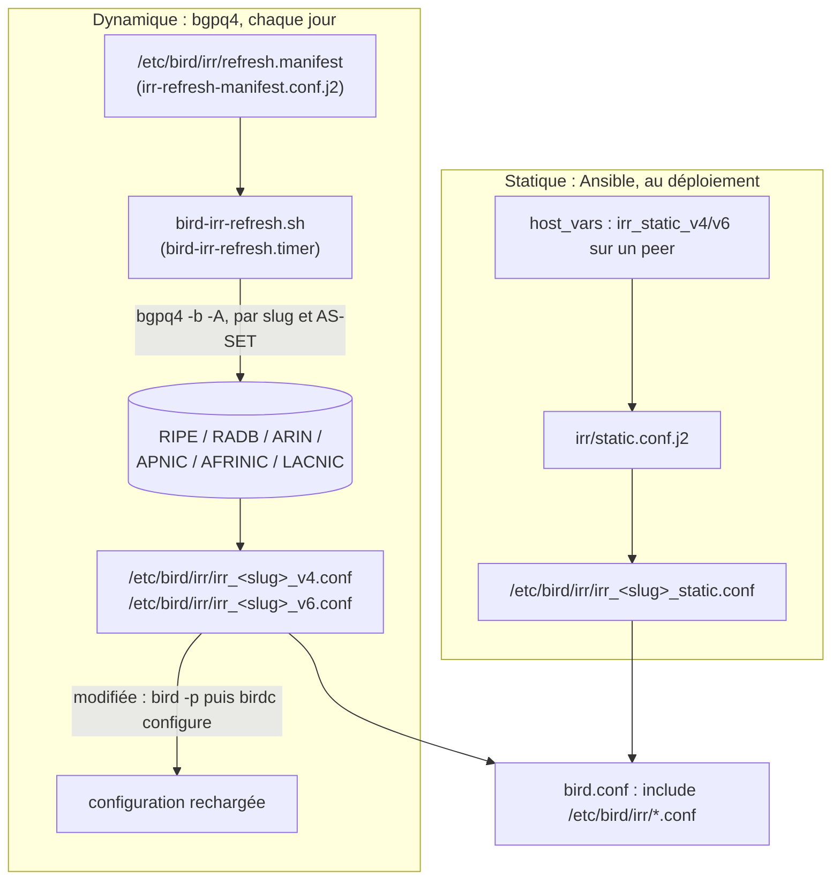

# Prefix-lists IRR

BIRD 3 n'a pas de client IRR : filtrer sur un objet IRR revient toujours à générer un `define irr_<slug>_v4/v6 = [...]` et à tester
`net ~ irr_<slug>_v4/v6` dans une fonction de filtrage. Deux mécanismes indépendants produisent ces définitions dans le même dossier
`/etc/bird/irr/`, que `bird.conf.j2` inclut en entier (`include "/etc/bird/irr/*.conf";`) avant `conf.d/*.conf`, puisque les fonctions qui
utilisent les symboles `irr_*` doivent être lues après eux. Les deux mécanismes suivent le même nommage, si bien que `peers/peering.conf.j2`,
`peers/client.conf.j2` et les fonctions de filtrage ignorent lequel a produit une liste donnée ; il faut seulement qu'un seul l'ait fait pour
chaque peer.

Nos propres préfixes ne passent pas par l'IRR : ils sont écrits en dur dans `NEUTRINET_PREFIXES_V4/V6` (`conf.d/10_bgp_filters_hygiene.conf.j2`).



## Qui est filtré

- `peering` : chaque peering bilatéral a `irr_filtered: true` et un `irr_as_set`. `irr_as_set_v6` est facultatif et sert quand le voisin publie
  un AS-SET distinct pour IPv6 (par exemple Hurricane Electric : `AS-HURRICANE` et `AS-HURRICANEV6`).
- `client` : la prefix-list est obligatoire et statique (`irr_static_v4/v6`) ; `tasks/config.yml` refuse un client sans elle, car elle sert aussi
  à l'anti-spoofing du pare-feu.
- `transit` et `route-server` : jamais filtrés par IRR. `tasks/config.yml` refuse `irr_filtered` sur ces types, où il ne filtrerait rien.

Exemple de peering :

```yaml
- asn: 6939
  name: Hurricane Electric
  slug: "6939_1"
  type: peering
  irr_filtered: true
  irr_as_set: "AS-HURRICANE"
  irr_as_set_v6: "AS-HURRICANEV6"
  max_prefix_v4: 420000
  max_prefix_v6: 360000
```

## Dynamique (bgpq4 et minuterie systemd)

`irr-refresh-manifest.conf.j2` écrit une ligne `<slug> <AS-SET> [<AS-SET IPv6>]` pour :

- chaque `peering` avec `irr_filtered: true` et sans `irr_static_v4/v6`.

Un peer qui a une liste statique est exclu du manifeste : un même symbole défini deux fois empêcherait BIRD de lire sa configuration.

`bird-irr-refresh.sh` (déployé par `tasks/config.yml`, lancé chaque jour par `bird-irr-refresh.timer` avec un décalage aléatoire de 30 min, et une
fois par `tasks/service.yml` avant le démarrage de BIRD) lit ce manifeste et, pour chaque entrée et chaque famille, lance
`bgpq4 -b -A -S RIPE,RADB,ARIN,APNIC,AFRINIC,LACNIC -4|-6 -R 32|128 -l irr_<slug>_v4|v6 -- <AS-SET>`. bgpq4 n'écrit pas le mot-clé `define`, que
le script ajoute en tête de fichier.

Garde-fous du script :

- chaque appel à bgpq4 a un délai de 120 s et trois tentatives espacées de 5 s ; en cas d'échec, l'ancienne liste est gardée ;
- si une liste d'au moins 20 préfixes varie de plus de 20 %, l'ancienne liste est gardée et le service se termine en erreur ; pour accepter le
  changement, supprimer le fichier `/etc/bird/irr/irr_<slug>_<af>.conf` et relancer le service ;
- un échec du service ne bloque pas le déploiement : `tasks/service.yml` l'affiche et continue, et l'unité en échec déclenche l'alerte
  systemd de l'Alertmanager ;
- si l'AS-SET ne contient aucun préfixe, l'ancienne liste est gardée ; s'il n'y en a pas, le script écrit une liste qui ne correspond à rien
  d'acceptable (`0.0.0.0/32` ou `::/128`), pour que le symbole existe ;
- les listes des peers retirés du manifeste sont supprimées ;
- un fichier n'est remplacé que si son contenu change ; après des remplacements, la configuration est validée par `bird -p`, puis chargée par
  `birdc configure`. Si l'une des deux étapes échoue, ou si le script est interrompu (`INT`, `TERM`), les listes précédentes sont restaurées.

## Statique (gérée par Ansible)

Pour un client dont les préfixes sont connus et fixes, par exemple une CPE à ASN privé sans objet IRR, `irr_static_v4` et `irr_static_v6` se
renseignent directement dans les host_vars, toujours ensemble :

```yaml
- asn: 65264
  name: verixi
  slug: "65264_41"
  type: client
  max_prefix_v4: 500
  max_prefix_v6: 1000
  irr_static_v4:
    - "80.67.191.0/24+"
    - "100.126.255.0/24+"
  irr_static_v6:
    - "2001:913:1d00::/40+"
    - "2001:913:1e00::/40+"
```

En production, les clients ISPng (80.67.181.128/25+, 2001:913:1f00::/40+) et NS-Global (23.128.97.0/24+, 2607:7c80:53::/48+) utilisent aussi une
liste statique.

`irr/static.conf.j2` produit `/etc/bird/irr/irr_<slug>_static.conf`, déployé et rechargé comme les autres fichiers de configuration, sans
minuterie ni requête externe : un changement prend effet au prochain passage d'Ansible. Les fichiers statiques d'un peer qui n'en a plus sont
supprimés.

La même liste alimente le pare-feu : l'anti-spoofing de l'accès du client et le filtre de sortie (BCP 38) de toutes les bordures. Un préfixe
client hors de nos agrégats doit donc arriver sur les bordures avant que la route soit annoncée, sinon elles jettent son trafic sortant.
`playbooks/apps/bird.yml` déploie pour cela nftables sur tous les routeurs avant BIRD. `--limit` s'applique aux deux plays : après un ajout de
préfixe, inclure les bordures (`-l <accès>,louise_network_edge`).

Un client à liste statique passe par les contrôles allégés `bgp_import_reject_static_client_v4/v6` (voir
[filters-and-communities.md](filters-and-communities.md)) : la liste écrite à la main fait foi, et le RPKI n'est vérifié que si l'ASN d'origine
est public.

## Peering sans `irr_filtered`

Un `peering` sans `irr_filtered: true` est refusé par un assert de `tasks/config.yml` : tout peering bilatéral est filtré par IRR.
